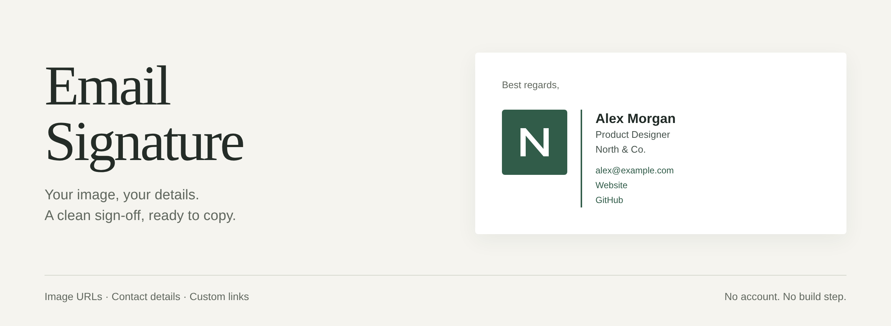
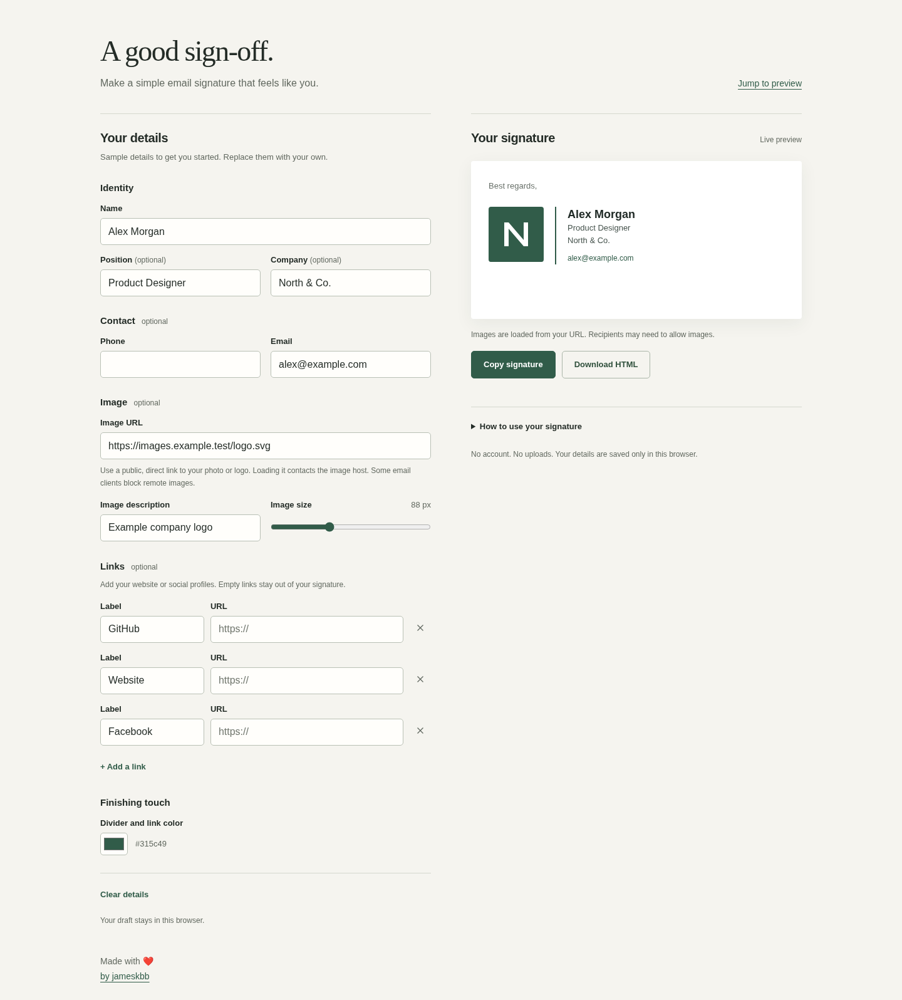

# Email Signature



[](https://jameskbb.github.io/email-signature/)

Make a clean email signature: image on the left, a solid divider, then your name, position, company, and optional contact links. Paste an image URL, edit your details, and copy the formatted result into your email settings.



[View the mobile editor](docs/images/editor-mobile.png).

Plain HTML, CSS, and JavaScript. No account, application dependencies, or build step. Your draft stays in this browser; the image host receives a request when you preview its image.

## Run

Open `index.html` directly, or serve it locally for the best clipboard support:

```sh
git clone https://github.com/jameskbb/email-signature.git
cd email-signature
python3 -m http.server 8000 --bind 127.0.0.1
```

Open http://localhost:8000. Replace the example details, paste a public direct image URL, and add any links you want. Blank optional fields disappear. Use **Copy signature**, then paste into your email client's signature editor. You can also download the HTML.

## GitHub Pages

To host your own copy, open **Settings > Pages**, choose **Deploy from a branch**, select **main** and **/ (root)**, and save. No build configuration or workflow is needed; `.nojekyll` is included. See [GitHub's publishing instructions](https://docs.github.com/en/pages/getting-started-with-github-pages/configuring-a-publishing-source-for-your-github-pages-site).

The live app is at **https://jameskbb.github.io/email-signature/**. GitHub Pages serves other project copies at `https://<username>.github.io/<repository>/`.

## Images and email clients

Use a direct HTTPS URL to a publicly accessible PNG or JPEG, not a page containing the image or a link that requires a login. The image remains hosted at that address; this app does not upload or embed it. Use a square photo or logo for predictable sizing.

The exported signature uses tables and inline styles. Email clients can change formatting, and recipients may block remote images. Send yourself a test email in your chosen client. Rich clipboard support varies by browser and requires a secure context; the app offers a manual selection fallback if copying fails. See [clipboard browser requirements](https://developer.mozilla.org/en-US/docs/Web/API/Clipboard/write).

Drafts use browser local storage, which can be unavailable in private browsing or for local files. Downloaded HTML includes the contact details and image URL you entered.

## Development

Node 22 or later is needed only for checks:

```sh
npm test
```

For browser checks and fresh screenshots, keep the local server running, then:

```sh
npm ci
npx playwright install chromium
npm run test:browser
```

The browser tests accept `BASE_URL` to test another local address or a project subpath. Playwright is the only development dependency and is never served to visitors. There is no build output.

Regenerate the README title card with `npm run docs:title` after installing the browser dependencies above. Its source is [docs/src/title-card.html](docs/src/title-card.html); the renderer uses a 1200 × 440 canvas at 2× resolution and needs no server. Keep the title card current when the product's appearance changes, and regenerate the editor screenshots with `npm run test:browser` when the interface changes.

[MIT licensed](LICENSE). This is a working static tool; email-client rendering still needs checking in the clients you use.

Made with ❤️<br>
by [jameskbb](https://github.com/jameskbb)
